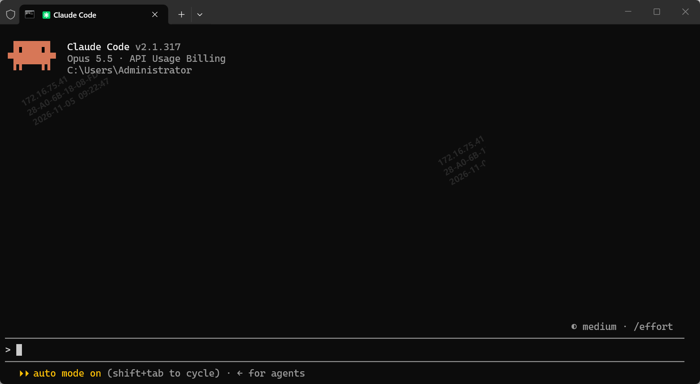

# Claude Code CLI教程

**Claude Code CLI 是什么？** Claude Code CLI 是 Anthropic 推出的终端版 AI 编程智能体：你用自然语言下指令，它直接在你的项目里读代码、改文件、跑命令和测试、提交 Git 并开 PR，而不是只给你一段要手动复制的代码片段。

# 1.安装

确保电脑安装了**node.js**可以在命令行使用 

```shell
npm -v
```

如果有版本号出现就可以了。

然后安装

```shell
npm install -g @anthropic-ai/claude-code
```

也可以指定特定版本安装

```shell
npm install -g @anthropic-ai/claude-code@2.1.317
```

# 2.配置

进入指定目录目前对应目录下
C:\Users\你当前的用户\.claude
我的电脑目录就是
C:\Users\Administrator\.claude
在里面找到**.config.json**

```
{
  "env": {
    "ANTHROPIC_AUTH_TOKEN": "你自己Claude Code的账号 apikeys",
    "ANTHROPIC_BASE_URL": "https://open.bigmodel.cn/api/anthropic",
    "API_TIMEOUT_MS": "3000000",
    "CLAUDE_CODE_DISABLE_NONESSENTIAL_TRAFFIC": 1,
    "DISABLE_AUTOUPDATER": "1"
  }
}
```

一些特殊原因，可能这种账号需要一些特殊方法才能使用。或者使用一些国内可以兼容Claude Code的。
可以使用智谱清言的。


# 3.使用

然后WIN+R 输入CMD控制台。
输入指令claude就出现控制台，可以正常使用了。

