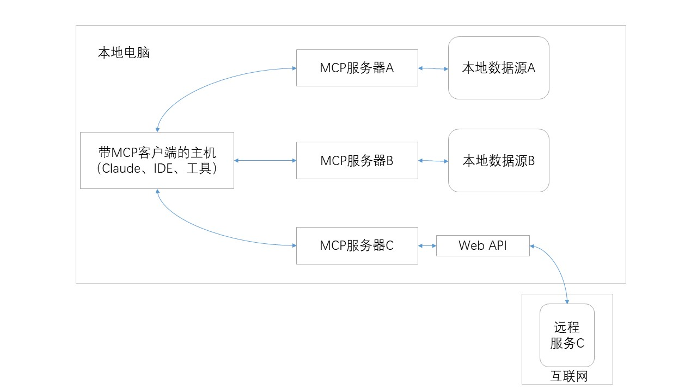

# Model Context Protocol(MCP)

Anthropic公司推出的AI通用接口，对接Claude,ChatGPT

桥接对象：AI聊天、IDEs、数据库、开发工具（Git）、生产工具（Google Map）以及其他AI接口

# MCP能够使能什么？

- 笔记软件的AI助手

- Claude Code生成网页应用

- 企业聊天机器人对接数据库

- 用Blender的3D设计模型打印

# MCP核心概念

- Resources:类似文件的数据可以被客户端读取的

- Tools：可以被大语言模型调用的函数

- Prompts：提示词，帮助用户完成特定任务

# 开启服务器

uv run python weather_server.py

# 测试

uv run fastmcp inspector weather_server.py

http://localhost:5173

# 测试 get_alerts

uv run fastmcp call weather_server.py get_alerts state=CA

# 测试 get_forecast

uv run fastmcp call weather_server.py get_forecast latitude=39.74 longitude=-97.09

# 测试 test_mcp

uv run fastmcp call weather_server.py test_mcp word=gogogo
